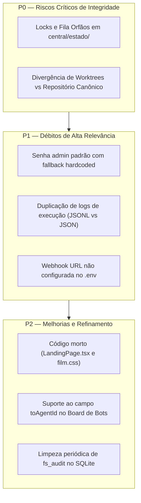

# DIAGNÓSTICO TÉCNICO DA PLATAFORMA CENTRAL DE AUDITORIA E HANDOFF
**Auditoria de Arquitetura, Funcionalidades, Segurança e Desempenho**
*Data da Avaliação: 2026-11-21 | Versão Avaliada: 2.1 (Pós-Fase 4)*

---

## 1. RESUMO EXECUTIVO

A Central de Auditoria e Handoff evoluiu de um conjunto esparso de scripts locais para uma aplicação web full-stack estruturada, resiliente e tipada em TypeScript. A plataforma possui backend Express com SQLite nativo, controle estrito de concorrência, barramento de eventos SSE em tempo real, integração com GitHub e uma rica interface React construída sob o design system "Blueprint de Guerra" e "Sala de Comando".

---

## 2. DIAGNÓSTICO POR PILAR OPERACIONAL

### 2.1. Gestão de Handoffs
- **Status:** ROBUSTO / PARCIALMENTE AUTOMATIZADO.
- **Funcionamento Atual:** 
  - Leitura e parsing de arquivos `.md` estruturados com metadados yaml/markdown em `central/ondas/<onda>/handoffs/`.
  - Máquina de estados formal (`server/phase1/stateMachine.ts`) que previne transições ilegais (ex: `PENDENTE` direto para `CONCLUÍDO`).
  - Atualização com preservação de formatação via `server/centralStore.ts` e gravação atômica (`server/persistence.ts`).
- **Gaps Identificados:**
  - A máquina de estados valida arestas do grafo, mas não impõe validação baseada no ator (qualquer requisição autenticada pode forçar transição se o endpoint for chamado).
  - O arquivamento de handoffs encerrados não possui rota de "archive" dedicada; todos permanecem no diretório ativo da onda.

### 2.2. Gestão de Auditorias e Parecer 24
- **Status:** OPERACIONAL / ALTA CONFIABILIDADE DOCUMENTAL.
- **Funcionamento Atual:**
  - Visualização de relatórios forenses em `central/ondas/<onda>/auditoria/`.
  - Exibição e cadastro de pareceres do Agente 24 com vereditos tipados (`APROVADO`, `REPROVADO`, `BLOQUEADO`).
  - Geração de relatório executivo em HTML standalone (`GET /api/central/report`).
  - Recente adição de suporte a prévias de parecer via Gemini AI (`server/geminiService.ts`).
- **Gaps Identificados:**
  - O gate de aprovação técnica ainda depende da integridade dos executores reportarem os comandos e códigos de saída na seção `## Resolução`.
  - Falta um verificador automatizado de evidências que parseie o bloco markdown e valide se o comando possui saída não-vazia e exit code 0.

### 2.3. Coordenação e Roster de Agentes
- **Status:** FUNCIONAL / SUPORTE MULTIPROVEDOR.
- **Funcionamento Atual:**
  - Roster oficial documentado em `PRODUCT.md`, `src/data/agentsRoster.ts` e `central/agents/registry.json`.
  - Suporte a múltiplos tipos de despacho: `subagente` (Devin), `cli` (Claude Code, Codex), `manual` (Antigravity, Copilot) e `api` (Gemini, OpenAI, xAI).
  - Script autônomo `detect-agents.mjs` que detecta binários disponíveis no PATH da máquina.
  - Workspace `AgentBotsWorkspace.tsx` com visualização de Membros, Quadro de interações e Galeria.
- **Gaps Identificados:**
  - O campo de destinatário no Quadro de mensagens (`AgentBotsWorkspace`) é inferido com base na ordem dos turnos (`00 -> especialista -> 24`). Mensagens ainda não possuem campo canônico `toAgentId` no tipo `AgentBotMessage`.
  - Inexistência de um status de agente aposentado (`RETIRED`) no modelo de dados.

### 2.4. Filas, Concorrência e Execução
- **Status:** EXCELENTE ROBUSTEZ TÉCNICA.
- **Funcionamento Atual:**
  - Semáforo FIFO (`server/taskQueue.ts`) com limite configurável (`CENTRAL_MAX_CONCURRENCY=2`), encapsulando rotas pesadas.
  - Mutex de arquivo com tempo limite e recuperação de stale locks (`withFileLockSync` / `withFileLock`).
  - Gerenciamento de worktrees isolados (`server/phase1/worktree.ts`) para evitar colisões no git do repositório alvo.
  - Gravação de logs de despacho em `central/estado/fila/` e locks em `central/estado/locks/`.
  - Graceful shutdown capturando SIGINT/SIGTERM com drenagem de fila em 15 segundos e fechamento gracioso do SQLite.
- **Gaps Identificados:**
  - Coexistência de dois sistemas de logging de execução: `centralExecutions.ts` (JSONL diário + SSE) e `phase1/executions.ts` (JSON por executionId).
  - Os 4 locks do lote anterior expiraram em 19/11 e permaneceram como arquivos no disco em `central/estado/locks/`, exigindo limpeza manual ou comando de purge.

### 2.5. Interface e Experiência do Desenvolvedor (UX/UI)
- **Status:** ALTO PADRÃO VISUAL E RESPONSIVIDADE.
- **Funcionamento Atual:**
  - Design cinematográfico "Sala de Comando" com grid interativo de partículas (`ParticleField`), telemetria em canvas (`TelemetryCanvas`), KPIs animados e View Transitions nativas.
  - Widget flutuante `ChatBootWidget` com comando de voz nativo em português (Web Speech API).
  - Explorador e Editor sandboxed com suporte a breadcrumb, contagem de linhas/caracteres, salvamento seguro e atalho `Ctrl+S`.
  - Tema dark por padrão com paleta semântica estrita (tokens `ink-*`, `paper-*`, `accent-*`).
- **Gaps Identificados:**
  - Arquivos órfãos remanescentes no código: `LandingPage.tsx` e `src/film.css` (foram desacoplados mas continuam presentes no repositório).
  - Comando de voz depende de `webkitSpeechRecognition`, indisponível em navegadores sem suporte webkit (Firefox), necessitando de aviso de fallback claro.

### 2.6. Persistência e Segurança
- **Status:** COMPLIANT / SANDBOXED.
- **Funcionamento Atual:**
  - Banco SQLite embutido via Node 22 native `node:sqlite` (`DatabaseSync`), sem dependências nativas C++ pesadas.
  - Transações com PRAGMA foreign_keys = ON e journal_mode = WAL.
  - Autenticação por cookie HttpOnly, hash scrypt, expiração de sessão em 7 dias e middleware `requireAuth` em todas as rotas `/api/*`.
  - FS API sandboxed: restrita estritamente a raízes pré-aprovadas (`C:\Github`), com bloqueio contra path traversal (`..`), limite de leitura de 512KB e escrita de 2MB.
- **Gaps Identificados:**
  - Credencial de fallback admin hardcoded (`birthhub360`) quando a variável `CENTRAL_ADMIN_PASSWORD` não está definida.
  - Logs de auditoria do sistema de arquivos (`fs_audit`) crescem indefinidamente sem política automática de expurgo.

---

## 3. AUDITORIA DE TESTES E QUALIDADE DE CÓDIGO

| Suíte de Testes | Quantidade | Status | Cobertura / Objetos Testados |
|---|---|---|---|
| `server/persistence.test.ts` | 5 | PASSOU | Atomic write, file locking, stale lock recovery, sync lock |
| `server/centralStore.test.ts` | 4 | PASSOU | getCentralState, path traversal rejection, status update, dispatch conflict |
| `server/coordinator.test.ts` | 3 | PASSOU | coordinator dryRun (slots/justificativas), real-run audit trail |
| `server/db.test.ts` | 8 | PASSOU | resolveDbPath, pragmas SQLite, users/sessions cascade, provider upsert, chat history, fs_roots/audit, dbStats, WAL mode |
| `server/geminiService.test.ts` | 7 | PASSOU | Model hydrogen/flash, error handling, normalization of review verdicts, diagnosis parser, code audit |
| `server/centralEvents.test.ts` | 4 | PASSOU | Event emission, replay buffer (200), filter by type |
| `server/centralMetrics.test.ts` | 4 | PASSOU | Lead time, rejection rates, blocked handoffs, PR metrics |
| `server/centralReport.test.ts` | 3 | PASSOU | Executive HTML generation, escaping, multi-wave report |
| `server/taskQueue.test.ts` | 6 | PASSOU | Semaphore FIFO, queue rejection, drain graceful shutdown |
| `server/waveOnboarding.test.ts` | 4 | PASSOU | Wave structure scaffolding, input validation, template generation |
| `server/phase1/phase1.test.ts` | 11 | PASSOU | Locks, leases, state transitions, adapters, worktrees, 409 conflict |
| `src/utils/auditReportExporter.test.ts` | 2 | PASSOU | Technical report aggregation, PDF/JSON serialization |
| `src/utils/governanceEngine.test.ts` | 10 | PASSOU | AGENTS.md personas, slot groups 01/01A, 06/06A, 08/08A, queue conflicts, file ownership |
| `src/utils/gridParticles.test.ts` | 5 | PASSOU | Canvas particles math, clamping, deterministic lattice |
| `src/utils/webhookNotifier.test.ts` | 3 | PASSOU | SSRF protection, Slack/Discord payload formatting |
| **TOTAL** | **89** | **100% OK** | **Suíte completa verde sem nenhuma quebra** |

---

## 4. MATRIZ DE DÍVIDAS TÉCNICAS E VULNERABILIDADES

