# ÍNDICE MESTRE DA CENTRAL DE AUDITORIA E HANDOFF
**Plataforma Autônoma de Governança Multiagente**
*Versão de Consolidação Mestre: 2026-11-21 | Status: HOMOLOGADO PARA PLANEJAMENTO*

---

## 1. APRESENTAÇÃO E MISSÃO

A **Central de Auditoria e Handoff** é uma infraestrutura independente de governança, auditoria, orquestração e acompanhamento técnico para ecossistemas multiagente e desenvolvedores solo. 

Sua função essencial **não é desenvolver os códigos dos projetos auditados**, mas sim:
1. Receber e estruturar missões, tarefas e achados de auditoria.
2. Distribuir e despachar handoffs para agentes autônomos e CLIs (Devin, Claude Code, Codex, Antigravity, Copilot, APIs).
3. Gerenciar worktrees isolados, locks e máquinas de estados para evitar corridas e regressões.
4. Exigir e auditar evidências empíricas reais (comandos, códigos de saída, logs, testes).
5. Submeter entregas à revisão independente (Agente 24) antes de qualquer autorização de merge ou deploy.
6. Prover observabilidade em tempo real (SSE, métricas, logs JSONL, relatórios executivos).

---

## 2. ESTRUTURA DOCUMENTAL OFICIAL DA CENTRAL

Esta consolidação mestre organiza e unifica toda a documentação da Central nas seguintes referências canônicas:

| ID | Documento Oficial | Função e Escopo | Status |
|---|---|---|---|
| **DOC-01** | [central/INDEX.md](file:///C:/Github/Central-de-Auditoria-e-Handoffs/central/INDEX.md) | Índice geral, catálogo de governança e mapa de navegação | ATUALIZADO |
| **DOC-02** | [central/INVENTARIO-HANDOFFS-ENCERRADOS.md](file:///C:/Github/Central-de-Auditoria-e-Handoffs/central/INVENTARIO-HANDOFFS-ENCERRADOS.md) | Inventário completo de handoffs das sessões anteriores | ATUALIZADO |
| **DOC-03** | [central/RELATORIO-VALIDACAO-HANDOFFS.md](file:///C:/Github/Central-de-Auditoria-e-Handoffs/central/RELATORIO-VALIDACAO-HANDOFFS.md) | Relatório de validação e confronto documental x real | NOVO / CONSOLIDADO |
| **DOC-04** | [central/DIAGNOSTICO-TECNICO-PLATAFORMA.md](file:///C:/Github/Central-de-Auditoria-e-Handoffs/central/DIAGNOSTICO-TECNICO-PLATAFORMA.md) | Diagnóstico arquitetural, frontend, backend, APIs e testes | NOVO / CONSOLIDADO |
| **DOC-05** | [central/BACKLOG-MESTRE.md](file:///C:/Github/Central-de-Auditoria-e-Handoffs/central/BACKLOG-MESTRE.md) | Backlog priorizado da própria plataforma da Central | NOVO / CONSOLIDADO |
| **DOC-06** | [central/PLANO-MESTRE-EXECUCAO.md](file:///C:/Github/Central-de-Auditoria-e-Handoffs/central/PLANO-MESTRE-EXECUCAO.md) | Estratégia global de execução e governança da Central | NOVO / CONSOLIDADO |
| **DOC-07** | [central/PLANO-ONDAS.md](file:///C:/Github/Central-de-Auditoria-e-Handoffs/central/PLANO-ONDAS.md) | Detalhamento das Ondas 0 a 6 com escopo, critérios e checklists | NOVO / CONSOLIDADO |
| **DOC-08** | [central/MATRIZ-AGENTES.md](file:///C:/Github/Central-de-Auditoria-e-Handoffs/central/MATRIZ-AGENTES.md) | Cadastro, capacidades, limitações e missões dos agentes | NOVO / CONSOLIDADO |
| **DOC-09** | [central/MATRIZ-DEPENDENCIAS.md](file:///C:/Github/Central-de-Auditoria-e-Handoffs/central/MATRIZ-DEPENDENCIAS.md) | Mapeamento de dependências técnicas, de infraestrutura e humanas | NOVO / CONSOLIDADO |
| **DOC-10** | [central/CHECKLIST-MESTRE.md](file:///C:/Github/Central-de-Auditoria-e-Handoffs/central/CHECKLIST-MESTRE.md) | Checklist mestre verificável de integridade da Central | NOVO / CONSOLIDADO |
| **DOC-11** | [central/MATRIZ-RISCOS.md](file:///C:/Github/Central-de-Auditoria-e-Handoffs/central/MATRIZ-RISCOS.md) | Registro de riscos técnicos, operacionais e mitigações | NOVO / CONSOLIDADO |
| **DOC-12** | [central/REGISTRO-DECISOES.md](file:///C:/Github/Central-de-Auditoria-e-Handoffs/central/REGISTRO-DECISOES.md) | Registro formal de decisões humanas D-01 a D-07 | ATUALIZADO |
| **DOC-13** | [central/PLANO-TESTES-HOMOLOGACAO.md](file:///C:/Github/Central-de-Auditoria-e-Handoffs/central/PLANO-TESTES-HOMOLOGACAO.md) | Plano de testes automatizados, manuais e homologação E2E | NOVO / CONSOLIDADO |
| **DOC-14** | [central/MEMORIA-OPERACIONAL.md](file:///C:/Github/Central-de-Auditoria-e-Handoffs/central/MEMORIA-OPERACIONAL.md) | Reconciliação histórica das sessões, PRs e worktrees | NOVO / CONSOLIDADO |
| **DOC-15** | [central/PLANO-CONTINUIDADE.md](file:///C:/Github/Central-de-Auditoria-e-Handoffs/central/PLANO-CONTINUIDADE.md) | Protocolos de continuidade operacional, disaster recovery e handover | NOVO / CONSOLIDADO |

---

## 3. ARQUITETURA E COMPONENTES TÉCNICOS

```mermaid
flowchart TD
    subgraph UI ["Interface Local (React 18 + Vite + Tailwind)"]
        Dashboard["Sala de Comando (DashboardView)"]
        AuditView["Ondas e Missões (CentralAuditView)"]
        HandoffView["Central de Handoffs (HandoffsCenterView)"]
        ReviewView["Auditoria e Parecer 24 (AuditReviewView)"]
        BotsWorkspace["Workspace de Bots (Membros / Quadro / Galeria)"]
        FilesIDE["Explorador & IDE Sandboxed (FilesView)"]
        ChatWidget["Widget Coordenador Flutuante (Voz / WebSpeech)"]
    end

    subgraph Server ["Backend Local (Node.js + TSX + Express)"]
        Auth["Auth Local (scrypt + HttpOnly Cookie)"]
        CentralRouter["/api/central (Rotas de Estado, Handoffs e Ondas)"]
        CoordinatorEngine["Motor Coordenador (server/coordinator.ts)"]
        AgentRuntime["Runtime de Agentes & Swarms (server/agentRuntime.ts)"]
        GeminiService["Serviço de IA Gemini (server/geminiService.ts)"]
        TaskQueue["Fila & Semáforo de Concorrência (server/taskQueue.ts)"]
        EventBus["Barramento SSE & Replay (server/centralEvents.ts)"]
        Persistence["Escrita Atômica & Mutex File Lock (server/persistence.ts)"]
    end

    subgraph Storage ["Camada de Persistência & Estado"]
        SQLite[("data/central.db (SQLite)")]
        HandoffStore["central/ondas/*/handoffs/*.md"]
        AuditStore["central/ondas/*/auditoria/*.md"]
        StateJson["central/estado/central-state.json"]
        ExecLog["central/estado/executions/*.jsonl"]
        Fila["central/estado/fila/"]
        Locks["central/estado/locks/*.json"]
    end

    UI -->|HTTP / SSE| Server
    Server --> Storage
```

---

## 4. REGRAS DE OURO DA CENTRAL

1. **Separação de Contexto:** A Central audita repositórios externos (ex.: `Birthub-360`). Jamais execute correções do produto auditado dentro do código-fonte da Central.
2. **Evidência Obrigatória:** Nenhuma tarefa é `CONCLUÍDO` sem comando executado, código de saída e parecer favorável do Agente 24.
3. **Isolamento via Worktrees:** Cada executor trabalha em worktree e branch exclusivos. Dois agentes nunca operam no mesmo diretório de trabalho.
4. **Respeito à Concorrência:** Respeitar slots exclusivos (`01/01A`, `06/06A`, `08/08A`) e teto máximo de executores paralelos (`CENTRAL_MAX_CONCURRENCY`).
5. **Preservação Total:** Nenhuma modificação local ou branch de terceiros é descartada.
