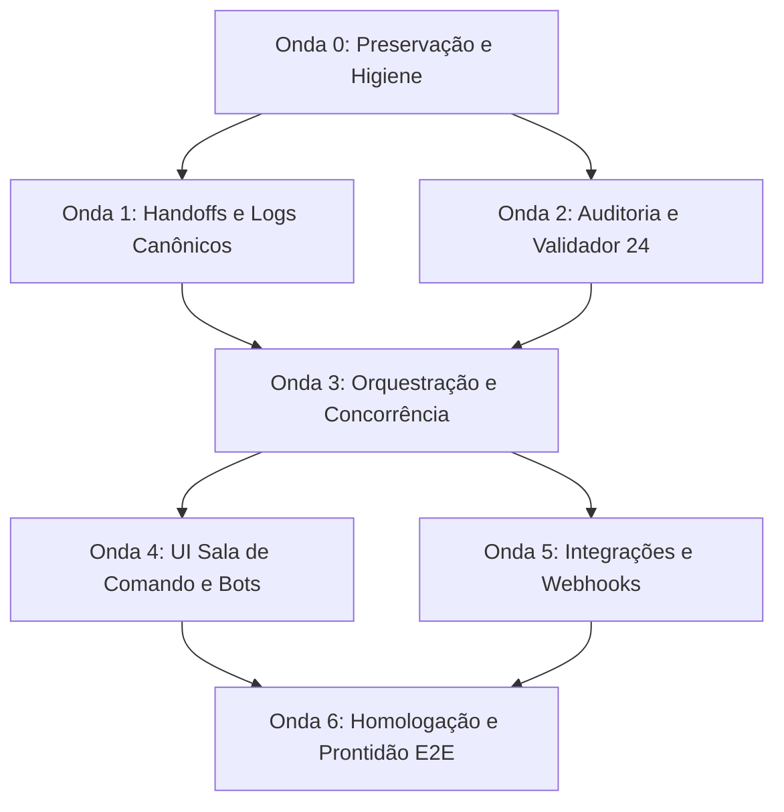

# MATRIZ DE DEPENDÊNCIAS TÉCNICAS E ESTRUTURAIS
**Mapeamento de Interdependências de Módulos, Ondas e Decisões**
*Versão: 2.0 | Data: 2026-11-21 | Status: HOMOLOGADO*

---

## 1. DEPENDÊNCIAS ENTRE ONDAS DA CENTRAL

---

## 2. MATRIZ DE DEPENDÊNCIA POR COMPONENTE

| Módulo / Atividade | Depende Diretamente De | Tipo de Dependência | Impacto de Bloqueio |
|---|---|---|---|
| **Preservação de Trabalho Local** | Autorização do Orquestrador Humano | Humana / Governança | **Crítico:** Risco de perda de código funcional já testado no repositório. |
| **Limpeza de Locks Expirados** | Onda 0 (Preservação) | Sequencial / Técnica | Impede despacho limpo do próximo lote de handoffs. |
| **Unificação de Logs JSONL** | `server/centralEvents.ts` e `phase1/executions.ts` | Arquitetural | Gera assimetria entre SSE ao vivo e arquivos de log diários. |
| **Parser de Evidências Reais** | `server/phase1/stateMachine.ts` | Backend / Validação | Risco de aceitação de handoffs com comandos falsos ou sem evidência. |
| **Trava de Abertura de PRs** | `central/ondas/*/revisoes/*.md` | Governança / Integração | Possibilidade de abertura de PR de código reprovado na auditoria. |
| **Configuração de Webhooks** | Fornecimento de URL HTTPS segura pelo Humano | Configuração / Infra | Notificações para Discord/Slack permanecem desabilitadas em `.env`. |
| **Serviço Gemini ao Vivo** | Declaração de `GEMINI_API_KEY` válida | Credencial / API | Fallback ativo (análises executadas apenas via mock local ou heurística). |
| **Drill de Restore de Backup (Target)** | Acesso ao host de produção EC2 (D-01) | Infraestrutura Externa | Script de restore testado apenas em sintaxe, sem validação contra banco real. |
| **Handoff de Retenção (00->01A)** | Ratificação das janelas LGPD (D-04) | Humana / Jurídica | Risco de expurgo precoce de dados de clientes ou descumprimento legal. |

---

## 3. DEPENDÊNCIAS DE CREDENCIAIS E AMBIENTE

| Variável / Recurso | Obrigatoriedade | Localização | Estado Atual | Mitigação / Fallback |
|---|---|---|---|---|
| `PORT` | Opcional (Default 3000 / 3123) | `.env` | Configurado | Usa fallback automático para 3100 se 3000 ocupada |
| `CENTRAL_ADMIN_PASSWORD` | Recomendada | `.env` | Ausente (Usa fallback) | Usa fallback de desenvolvimento `birthhub360` |
| `CENTRAL_MAX_CONCURRENCY`| Opcional (Default 2) | `.env` | Declarado | Semáforo FIFO ativo com teto 2 |
| `GEMINI_API_KEY` | Opcional para IA | `.env` | Não verificado no git | Mock testado nos testes unitários com êxito |
| `CENTRAL_NOTIFY_WEBHOOK` | Opcional | `.env` | Vazio (`""`) | Notificações silenciadas graciosamente sem erro |
| `GITHUB_TOKEN` | Opcional | `.env` / `gh` CLI | `gh` autenticado na máquina | Fallback via CLI nativa `gh` já testada |
| `DEVIN_API_KEY` | Opcional | `.env` | Configurável | Modo manual gera pacote de prompt na fila |
