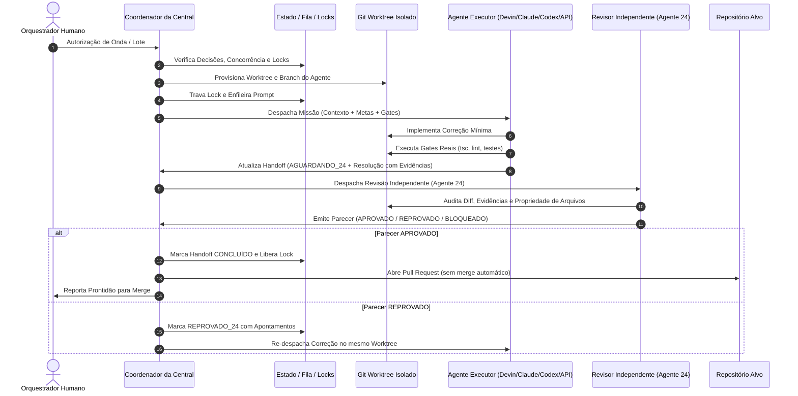

# PLANO MESTRE DE EXECUÇÃO DA CENTRAL DE AUDITORIA E HANDOFF
**Estratégia Operacional, Governança e Evolução da Plataforma**
*Versão: 2.0 | Data: 2026-11-21 | Status: HOMOLOGADO PARA APROVAÇÃO*

---

## 1. VISÃO GERAL E DIRETRIZES ESTRATÉGICAS

A **Central de Auditoria e Handoff** opera como o cérebro coordenador e autoridade de governança técnica para projetos de software desenvolvidos por múltiplos agentes de inteligência artificial ou desenvolvedores humanos.

### Diretrizes Inegociáveis:
1. **Governança Separada:** A Central possui seu próprio ciclo de vida, repositório e testes (`Central-de-Auditoria-e-Handoffs`). Os repositórios auditados (como `Birthub-360`) são alvos externos. Jamais misture seus backlogs, commits ou dependências.
2. **Prioridade da Evidência Empírica:** Código funcional ou referências textuais não constituem conclusão. Toda entrega exige comandos reais executados, códigos de retorno capturados (`exit 0`), logs de execução e validação independente pelo Agente 24.
3. **Isolamento de Executores:** Nenhum executor atua na branch principal ou em diretórios compartilhados. Toda tarefa é executada em git worktree isolado com branch temática dedicada.
4. **Respeito aos Bloqueios Humanos:** Nenhuma decisão que dependa do Orquestrador Humano pode ser improvisada ou contornada por heurísticas de agentes.

---

## 2. CICLO OPERACIONAL DE EXECUÇÃO

---

## 3. PRINCÍPIOS DE CONCORRÊNCIA E PREVENÇÃO DE CONFLITOS

1. **Teto de Execução Paralela (`CENTRAL_MAX_CONCURRENCY`):** Máximo de 2 a 4 executores simultâneos, evitando sobrecarga de IO, quota de APIs e concorrência no git.
2. **Slots Exclusivos de Arquivos:** Hand-offs que tocam em módulos correlatos não podem rodar em paralelo:
   - `01` e `01A` (Schema, RLS, Migrações e Retenção).
   - `06` e `06A` (Integrações Bitrix e Webhooks).
   - `08` e `08A` (QA Gates e CI/CD).
   - `16` e `06/07` (Workers e filas que impactam `src/lib/queue/**`).
3. **Arquivos Estritamente Protegidos:**
   - `server.ts`, `package.json`, arquivos de lock: Exigem aprovação explícita do Coordenador.
   - `prisma/schema.prisma`: Apenas o Agente 01 possui titularidade de edição.
   - Prompts de agentes e diretrizes de governança (`.agents/prompts/**`, `AGENTS.md`): Exclusividade do Orquestrador Humano.

---

## 4. MACRO-FLUXO DE EVOLUÇÃO POR ONDAS

A evolução da própria Central e o saneamento das pendências estão organizados em 7 ondas estratégicas:

- **ONDA 0 — PRESERVAÇÃO E RECUPERAÇÃO OPERACIONAL:** Salvaguarda de arquivos modificados, reconciliação de PRs e higienização de locks órfãos.
- **ONDA 1 — HANDOFFS E FONTE DE VERDADE:** Padronização documental, consolidação de metadados e unificação dos logs de execução.
- **ONDA 2 — AUDITORIA E VALIDAÇÃO INDEPENDENTE:** Formalização de verificadores automáticos de evidências e governança do Agente 24.
- **ONDA 3 — ORQUESTRAÇÃO E EXECUÇÃO ROBUSTA:** Fortalecimento do runtime de agentes, adapters headless e tolerância a falhas.
- **ONDA 4 — UX, UI E SALA DE COMANDO:** Refinamento do workspace de agentes, eliminação de código órfão e dashboard telemetria.
- **ONDA 5 — INTEGRAÇÕES E AUTOMAÇÕES EXTERNAS:** Configuração segura de webhooks, autenticação Gemini ao vivo e integração GitHub.
- **ONDA 6 — QUALIDADE, SEGURANÇA E HOMOLOGAÇÃO GERAL:** Testes de carga, validação de concorrência e emissão do relatório final de prontidão.
