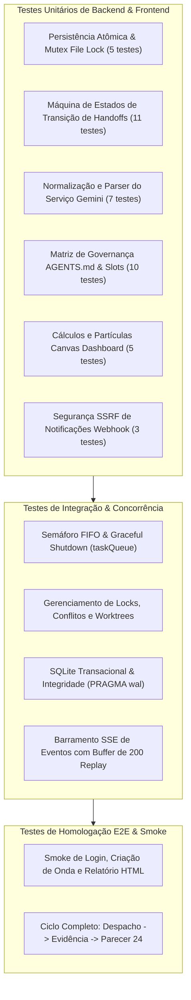

# PLANO DE TESTES, VALIDAÇÃO E HOMOLOGAÇÃO
**Estratégia de Asseguração da Qualidade da Central de Auditoria**
*Versão: 2.0 | Data: 2026-11-21 | Status: HOMOLOGADO*

---

## 1. PIRÂMIDE DE TESTES DA CENTRAL

---

## 2. MATRIZ DE SUÍTES DE TESTES AUTOMATIZADOS

| Arquivo de Teste | Quantidade | Escopo Técnico | Critério de Aceite |
|---|---|---|---|
| `server/persistence.test.ts` | 5 | Escrita atômica (tmp+rename), mutex file lock, recuperação de lock stale (30s) | Passar 100% sem deadlock |
| `server/centralStore.test.ts` | 4 | getCentralState, bloqueio a path traversal (`..`), updateHandoffStatus, conflito de dispatch | Rejeitar invasão e conflitos |
| `server/coordinator.test.ts` | 3 | coordinator dryRun (slots/justificativas), real-run gerando registros em `coordinator-runs/` | Alocar lotes estritamente |
| `server/db.test.ts` | 8 | Resolução de caminho, pragmas SQLite, deleção em cascata, upsert de providers, chat history, dbStats | Integridade SQLite = ok |
| `server/geminiService.test.ts` | 7 | Modelagem, tratamento de ausência de credenciais, normalização de pareceres, diagnóstico de handoffs | Fallback limpo sem crash |
| `server/centralEvents.test.ts` | 4 | Emissão de eventos no EventEmitter, buffer circular de 200 itens, replay por timestamp | Replay sem perda de eventos |
| `server/centralMetrics.test.ts` | 4 | Cálculo de lead time, taxa de reprovação 24, handoffs bloqueados, métricas de PR | Métricas coerentes |
| `server/centralReport.test.ts` | 3 | Geração de relatório executivo em HTML standalone, sanitização contra XSS, multi-onda | HTML válido e sanitizado |
| `server/taskQueue.test.ts` | 6 | Semáforo FIFO, rejeição de overflow, método `drain(15000)` para graceful shutdown | Drenagem em até 15s |
| `server/waveOnboarding.test.ts` | 4 | Scaffolding de diretórios de onda, validação de payload, template de handoff | Estrutura física criada |
| `server/phase1/phase1.test.ts` | 11 | Claim, renew, release de locks, transições de estado, adaptadores CLI/mock, HTTP 409 | Locks liberados e conflitos emitidos |
| `src/utils/auditReportExporter.test.ts` | 2 | Agregação de gates aprovados, vereditos, exportação binária de PDF e JSON | Arquivos válidos gerados |
| `src/utils/governanceEngine.test.ts` | 10 | AGENTS.md personas, slots exclusivos 01/01A, 06/06A, 08/08A, conflito de fila 16 x 06/07 | Conformidade total com AGENTS.md |
| `src/utils/gridParticles.test.ts` | 5 | Funções matemáticas determinísticas de canvas, lattice de pontos, influência magnética | Cálculos finitos delimitados |
| `src/utils/webhookNotifier.test.ts` | 3 | Bloqueio de SSRF, validação de URLs HTTP/HTTPS, payloads Discord e Slack | Bloqueio de IP privado/loopback |

---

## 3. PROTOCOLO DE HOMOLOGAÇÃO DE ENTREGAS

Antes de qualquer autorização de promoção de versão ou deploy da Central:
1. **Comando de Testes:** `npm test` deve retornar exit code 0 com **89/89 testes aprovados**.
2. **Checagem Estrita de Tipos:** `npm run lint` (`tsc --noEmit`) deve retornar zero erros.
3. **Build de Produção:** `npm run build` deve gerar os pacotes em `dist/` sem alertas impeditivos.
4. **Smoke Test de Portas:** O servidor deve subir com sucesso na porta configurada (`node --import tsx server.ts`).
5. **Teste de Autenticação:** A rota `/api/health` deve reportar integridade do banco SQLite e `/api/central/state` deve exigir cookie de autenticação ativo.
